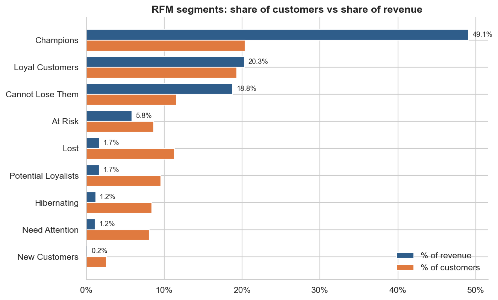
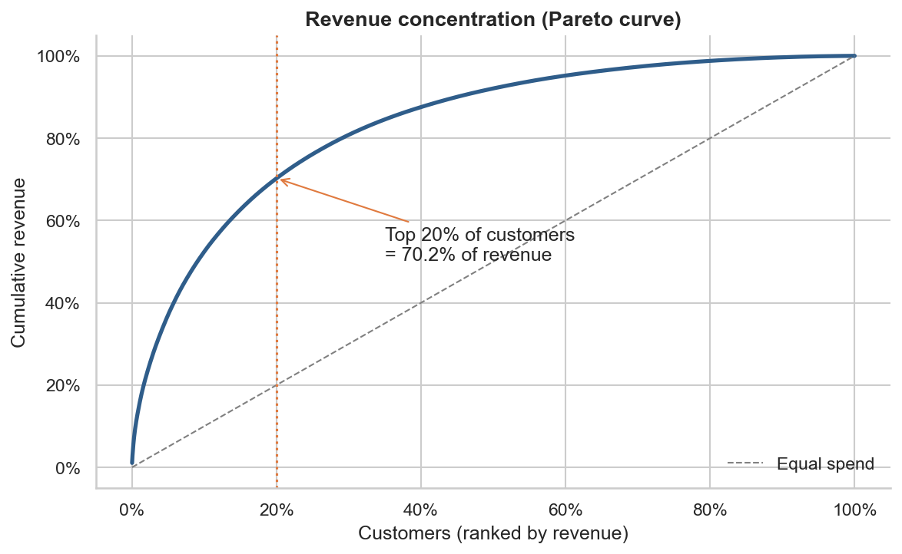
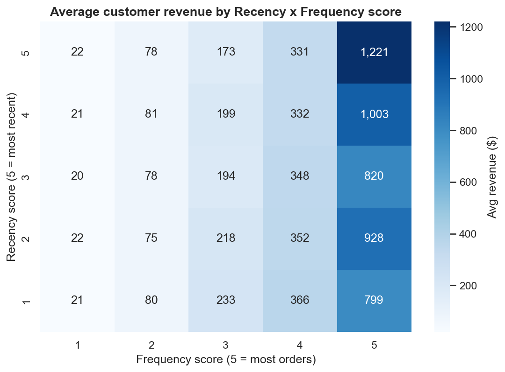
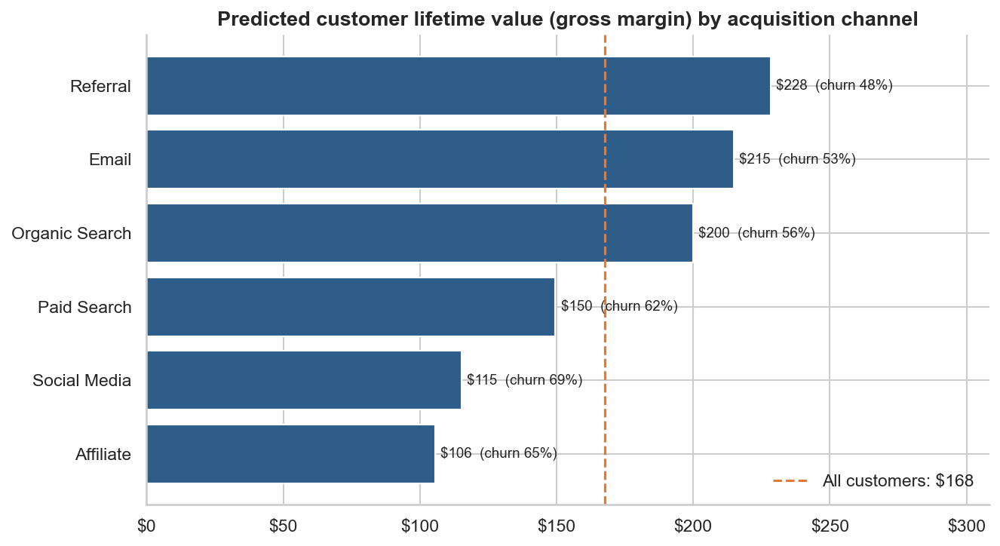
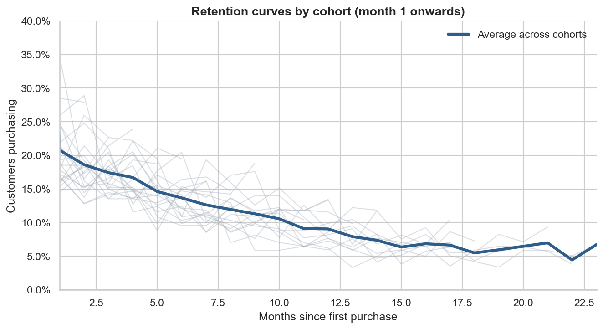
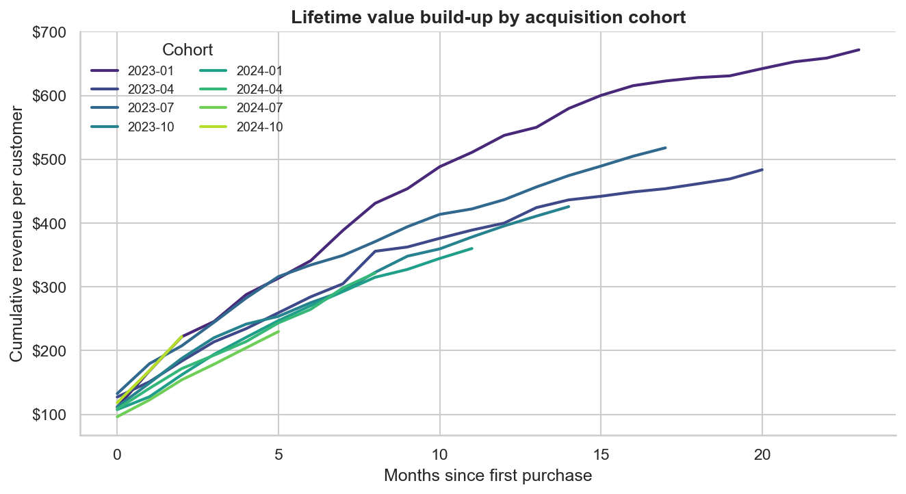
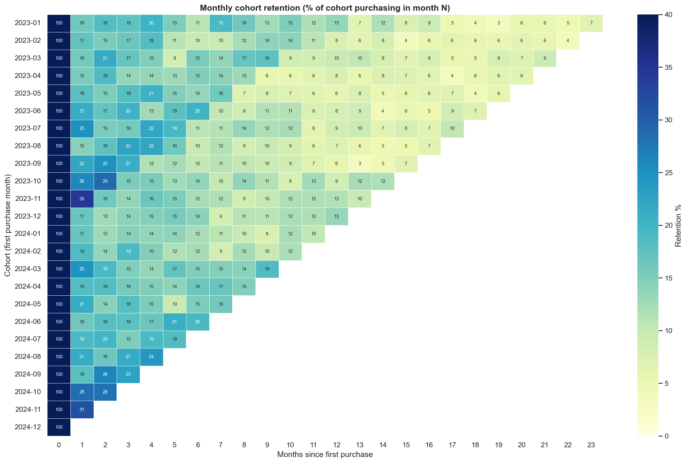
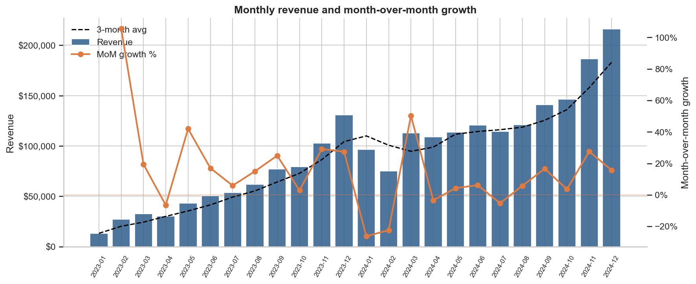

# E-Commerce Customer Lifetime Value (LTV) & Cohort Analysis

**Tools:** SQL (SQLite with CTEs and window functions) · Python (Pandas, Seaborn, Matplotlib) · Power BI · DAX

An end-to-end customer analytics project on two years of e-commerce transactions
(Jan 2023 to Dec 2024: 6,700+ customers, 19,000+ completed orders, $2.25M revenue). It covers:

- **RFM segmentation**: scores every customer on Recency, Frequency and Monetary value (1-5) with
  `NTILE` window functions and maps them to 9 actionable segments.
- **Monthly cohort retention**: builds retention grids that show what share of each
  acquisition cohort comes back N months after their first purchase.
- **Revenue concentration**: identifies the high-value segments driving most of the revenue.
- **CLV prediction**: churn-based lifetime value model, computed in Python and in DAX so the two reconcile.
- **Power BI dashboard**: MoM growth tracking and CLV prediction with dynamic DAX measures.

---

## Key results

| Metric | Value |
|---|---|
| Champions segment share of customers | **20.4%** |
| Champions segment share of revenue | **49.1%** |
| Revenue from top 20% of customers | 70.2% |
| Month-1 retention (avg across cohorts) | 20.8% |
| Month-12 retention | 9.0% |
| Annual customer churn | 59.2% |
| Predicted CLV (gross margin) | $167.70 |
| Best / worst acquisition channel by CLV | Referral $228 / Affiliate $106 |
| 2024 revenue growth YoY | +120.7% |

The full write-up is generated into [`reports/findings.md`](reports/findings.md).

**Takeaways**
1. **Revenue is highly concentrated.** One in five customers (Champions) generates almost half of all revenue.
   Protecting this segment with loyalty perks and early access is the highest-ROI retention play.
2. **"Cannot Lose Them" is the biggest at-risk pool.** These 782 customers have 18.8% of historical revenue
   but haven't bought in about a year. They are the first target for a win-back campaign.
3. **The first month decides retention.** Around 79% of new customers never return the following month.
   Onboarding flows and a second-purchase incentive have the most leverage.
4. **Channel quality varies about 2x.** Referral and Email customers are worth roughly twice as much as
   Affiliate and Social Media customers, so the cost to acquire a customer should be set per channel.

---

## Project structure

```
ecommerce-ltv-cohort-analysis/
├── run_pipeline.py              # runs everything end to end
├── requirements.txt
├── sql/
│   ├── 01_schema.sql            # tables, keys, constraints, indexes
│   ├── 02_clean_orders.sql      # cleaning view + cohort tagging (CTEs)
│   ├── 03_rfm_segmentation.sql  # RFM scores with NTILE() + segment rules
│   ├── 04_revenue_contribution.sql  # segment share, cumulative %, deciles (SUM() OVER, RANK)
│   ├── 05_cohort_retention.sql  # retention grid (FIRST_VALUE OVER PARTITION)
│   ├── 06_cohort_ltv.sql        # cumulative revenue per customer (running SUM)
│   ├── 07_monthly_kpis.sql      # MoM growth (LAG), 3M moving avg, YTD
│   └── 08_customer_summary.sql  # customer-level table for CLV + Power BI
├── src/
│   ├── generate_data.py         # reproducible synthetic dataset
│   ├── build_database.py        # loads CSVs into SQLite, runs the SQL
│   ├── rfm_analysis.py          # segment charts, RFM heatmap, Pareto curve
│   ├── cohort_analysis.py       # retention heatmap, curves, cohort LTV
│   ├── kpi_analysis.py          # revenue trend, MoM growth, new vs returning
│   ├── ltv_analysis.py          # CLV prediction by channel / country
│   └── export_powerbi.py        # star-schema CSVs for Power BI
├── data/                        # raw CSVs + ecommerce.db (generated)
├── reports/
│   ├── findings.md              # auto-generated summary of results
│   ├── figures/                 # charts (PNG)
│   └── tables/                  # result tables (CSV)
└── powerbi/
    ├── DAX_measures.dax         # all DAX measures (MoM, cohort, RFM, CLV)
    ├── DASHBOARD_GUIDE.md       # step-by-step dashboard build
    └── data/                    # model-ready CSVs
```

## How to run

```bash
pip install -r requirements.txt
python run_pipeline.py
```

This takes about 20 seconds. It regenerates the data, rebuilds the database, re-runs every SQL
query, and rewrites all charts, tables and `reports/findings.md`. Then follow
[`powerbi/DASHBOARD_GUIDE.md`](powerbi/DASHBOARD_GUIDE.md) to build the dashboard.

You can also explore the database directly with any SQLite client (e.g. DB Browser for SQLite or the
VS Code SQLite extension). Open `data/ecommerce.db` and query tables such as `rfm_segments`,
`cohort_retention` and `monthly_kpis`.

---

## Methodology

### Data
`src/generate_data.py` simulates a realistic store with a fixed random seed. Each customer has a hidden
engagement level, a monthly churn probability and a basket-size multiplier. Purchases are simulated
month by month with holiday seasonality (Nov/Dec peaks) and differences in channel quality. The data
includes cancelled/returned orders and guest checkouts, which the SQL layer removes
(`v_orders_clean`). 21,308 raw orders become 19,350 analysable orders.

### RFM segmentation (`sql/03_rfm_segmentation.sql`)
```sql
NTILE(5) OVER (ORDER BY recency_days DESC)  AS r_score,   -- 5 = most recent
NTILE(5) OVER (ORDER BY frequency, monetary) AS f_score,
NTILE(5) OVER (ORDER BY monetary)            AS m_score
```
Customers are mapped to segments by R and F score: Champions (R≥4, F≥4), Loyal Customers,
Potential Loyalists, New Customers, Cannot Lose Them, At Risk, Need Attention, Hibernating, Lost.

### Cohort retention (`sql/05_cohort_retention.sql`)
Cohort = month of first purchase. `month_number` = months since that cohort month.
Retention = active customers in month N ÷ cohort size, where cohort size is
`FIRST_VALUE(active_customers) OVER (PARTITION BY cohort_month ORDER BY month_number)`.

### Customer lifetime value (`src/ltv_analysis.py` and the DAX in section 6)
```
annual churn      = 1 − (customers active in prior 12m AND last 12m) / customers active in prior 12m
expected lifespan = min(1 / annual churn, 5 years)
predicted CLV     = (gross profit last 12m / active customers last 12m) × expected lifespan
```
The Python and DAX versions use identical windows, so the dashboard numbers can be checked against
`reports/tables/clv_*.csv`. CLV is compared across channels and countries rather than RFM segments,
because segments are defined by recency, which would make segment-level churn circular.

---

## Visuals

| | |
|---|---|
|  |  |
|  |  |
|  |  |




---

## Using a real dataset instead

The SQL and Python layers only depend on the four tables in `sql/01_schema.sql`. To run the project
on public data, such as the UCI *Online Retail II* dataset or the Olist Brazilian e-commerce dataset
on Kaggle, map its columns to `customers`, `orders`, `order_items` and `products`, save them as CSVs
in `data/raw/`, and run `python -m src.build_database` followed by the analysis modules (skip
`generate_data`).
